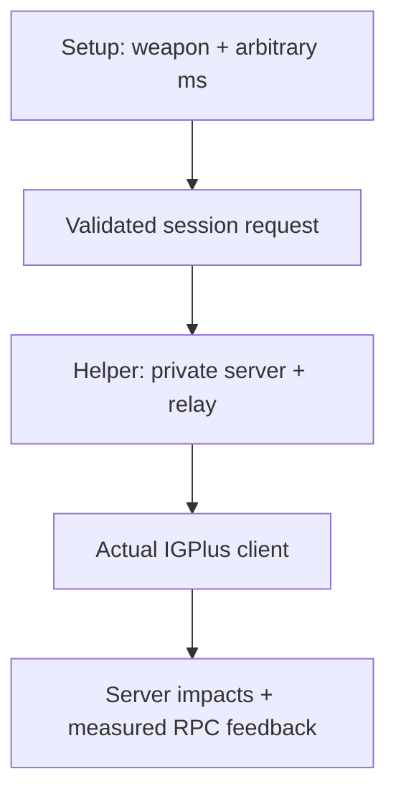

# WIP — selectable latency + IGPlus training

**Owner/credits: ToastyCL · Updated: 2026-11-09 (UTC)**

This is the implementation handoff for contributors, including scriptom. The requested outcome is a playable training room where the player chooses **any integer latency value**, uses actual IGPlus weapons/netcode, plays a round, sees accuracy over the world and returns to setup with a fresh fire press. It is work in progress, not a completed integrated mode.

## Current state

| Part | State | Entry point |
| --- | --- | --- |
| Local trainer, random spawns, round/results, About | Implemented; development build 0.3.1 | `UTAT/Classes` |
| Actual IGPlus 11 player + Shock/Sniper, real server hits | Implemented experimental proof | `UTATNetLab/Classes` |
| Arbitrary added RTT, not a list of presets | Implemented in external WIP launcher | `scripts/network_lab.py` |
| Single validated session contract | Implemented | `scripts/network_config.py` |
| UDP delay in both directions | Implemented, localhost only | `scripts/net_relay.py` |
| Manual IGPlus sandbox with no auto-aim/fire/exit | Implemented WIP | `net_smoke.py --manual` |
| Requested delay / RPC estimate / server impact feedback | WIP client messages + logs | `UTATNetProbe.uc` |
| Numeric field inside UT setup | Pending | Future UWindow integration |
| Start server/helper from in-game flow | Pending | Requires a supported helper/lifecycle bridge |
| Network rounds, unlimited ammo and per-weapon accuracy | Pending | Preserve IGPlus player/weapon behavior |
| Full result HUD, replay and cleanup across network rounds | Pending | Port lifecycle, not standalone player class |
| Windows/macOS and physical input acceptance | Pending | Test installations |

The normal compiled trainer **does not yet offer in-game latency selection**. Do not present the external launcher as an in-game feature. Existing local training is unaffected.

## Agreed behavior

- Free numeric input, initially **0–2000 ms in 1 ms increments**. Values such as 37, 85, 112 and 143 must survive validation and reach the relay unchanged. These bounds are an initial engineering guardrail, not a menu of presets.
- The value means **added round-trip delay**: 85 ms adds 42.5 ms each way. It is not an exact target for scoreboard ping, and it cannot reduce baseline latency.
- Show requested added RTT and measured RTT as distinct values. The current measurement is a frame/tick-sensitive client-clock RPC estimate, not hardware latency or certified wire RTT.
- Allow changes between rounds. Mid-round changes must be blocked until lifecycle and timing behavior are explicitly designed. Current WIP changes take effect by closing and relaunching the sandbox.
- Keep Local and IGPlus environments explicit. Local mode must not show fake ping or silently switch netcode.
- Keep the single Start training control. Missing dependencies should give an actionable error and leave setup available.
- Preserve the selected weapon, exercise, duration and latency through setup/travel/replay.
- Network result flow should match local training: statistics over the world; fresh primary fire returns to selection without shooting or changing counters.
- Jitter, packet loss and bandwidth simulation are separate future features, not implied by a selected fixed delay.

## Architecture and session contract

The external helper currently owns the private dedicated server, single-client loopback relay and UT client. `NetworkSession` validates configuration before process launch. One value feeds both the relay CLI and the server URL, so displayed requested delay matches configured delay.

```json
{
  "schema": 1,
  "environment": "IGPlus11-OldNet-WIP",
  "weapon": "Shock",
  "added_rtt_ms": 85
}
```

The launcher writes this non-personal request to `build/network-session.json`. It is a request record, not proof of successful connection. Future in-game/helper integration should use this same validated meaning and add an explicit ready/error handshake. Transport/IPC is not implemented yet; do not assume UnrealScript can safely start external processes itself.



IGPlus stays a separate runtime dependency. `UTATNetGame` loads its weapon classes dynamically, and UTPure chooses its own player class. **Do not force UTATPlayer**, which would bypass IGPlus player behavior. The tested normal-weapon profile is `WeaponSettingsOldNet`; IGPlus does not imply all normal weapons use NewNet compensation. Keep exact IGPlus version/settings/tick configuration in test evidence.

The static target currently counts positive server damage calls as **impacts**. This is not a shot denominator and must never be labeled accuracy. Network accuracy requires trustworthy emission counts and deduplication for each supported fire mode without substituting the standalone stock wrappers for IGPlus weapons. Splash, fragments, late projectiles and round IDs need explicit handling.

## Try the external WIP

Use a test copy of a full UT99 469e installation, the repository and separately installed [official IGPlus 11](https://github.com/utspect/InstaGibPlus/releases/tag/11). See [Network lab dependencies](NETWORK_LAB.md). Build the base mod/map, then the new WIP lab:

```sh
python scripts/build.py --ut-root "/path/to/UT"
python scripts/build_netlab.py --ut-root "/path/to/UT"
python scripts/network_lab.py --ut-root "/path/to/UT"
```

The last command asks for **Shock / Sniper**, then an arbitrary added RTT. It opens the actual IGPlus room and leaves aiming/firing to the player. It does not run timed rounds or compute accuracy. Close UT to stop; relaunch to select another delay. No in-game helper installation is provided yet. Use a new test UT process, not one already running.

Windows direct example (full Python/repository setup still required):

```text
py scripts/network_lab.py --ut-root "C:\Games\UnrealTournament" --weapon Shock --rtt-ms 85
```

The compiled `downloads/UTAT-network-lab-WIP.zip` contains only project package/docs, not the helper runtime, base mod or IGPlus. Building from this checkout is the preferred developer path. Extract its `System/UTATNetLab.u` into the test installation only if using the precompiled WIP package.

Linux developer checks, with a compatible SDL/Mesa renderer:

```sh
python -m unittest discover -s tests -v
python scripts/net_smoke.py --ut-root "/path/to/UT" --offscreen --weapon Shock --rtt-ms 37 --manual-check
python scripts/net_smoke.py --ut-root "/path/to/UT" --offscreen --weapon Sniper --rtt-ms 143
```

`--manual-check` initializes the same manual mode and confirms that it stays open without automatically firing. The second command explicitly runs the automated one-shot regression. Neither substitutes for physical input/visual testing. Run sequentially; localhost ports 17777 and 18777 are reserved. Closing/cancelling the launcher must stop its owned client/server/relay. No production server changes or external relay exposure are part of this work.

Executed developer checks: [WIP_NETWORK_CHECKS.md](WIP_NETWORK_CHECKS.md).

## Next implementation tasks

1. Add the UWindow environment selector and editable numeric field, with validation/error text and persisted settings. Avoid adding a disconnected field that looks operational.
2. Design the helper handshake and startup/stop ownership for Windows first. Report missing IGPlus, busy ports and failed connections; restore setup on failure. Do not shell-execute unchecked menu text.
3. Add authoritative round state/timing, selected duration and static/moving target lifecycle while retaining actual IGPlus player/weapon classes.
4. Add infinite ammo, supported-fire emission accounting and server-confirmed deduplicated hits. Keep accuracy unavailable until both numerator and denominator are valid.
5. Replicate round statistics and implement the result HUD / fresh-fire acknowledgement / replay behavior with IGPlus-compatible input handling.
6. Match an actual tester server's IGPlus build and settings, then validate manual mouse feel, moving targets and network behavior. Anticheat/ACE compatibility remains separate.

## Acceptance checklist for the integrated mode

- [ ] Enter 37 / 85 / 112 / 143; no rounding to presets and no silent fallback.
- [ ] Reject blank/negative/non-integer/out-of-range input with readable feedback.
- [ ] Requested delay is distinct from measured RTT; 0 means no additional delay.
- [ ] Packet-path validation confirms configured delay is split evenly by direction.
- [ ] Actual IGPlus pawn/weapon classes remain active; no standalone weapon substitution.
- [ ] Switching ms between rounds creates a fresh network session without stale delayed packets or old round scoring.
- [ ] Selected weapon/exercise/time/latency survive startup and replay.
- [ ] Timed rounds end on the server; results remain over the room until a fresh primary fire.
- [ ] Misses, hits, zero-shot rounds and supported fire modes produce correct accuracy ≤100%.
- [ ] Missing dependencies, startup failure and close/cancel leave no owned orphan processes.
- [ ] Physical Windows client acceptance; macOS/Linux acceptance recorded separately.

No GitHub Release or automatic deployment is required for this WIP.
